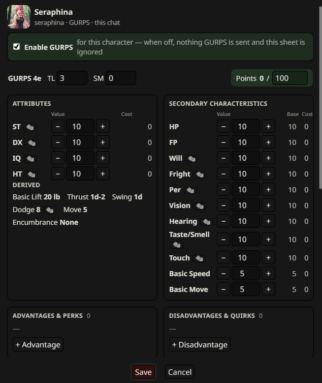

# NPC Book Character Sheet (SillyTavern extension)

A sister extension for [NPC Book](https://github.com/lalzy/ST-NPC-Book) that gives every NPC, and you, a character sheet (intended for use with the **GURPS® system**). Note that **No rules data is included** so you need to define all this yourself in **Extensions → NPC Book Character Sheet → Rules** (see [RULES.md](RULES.md)). Until you do, the sheet still works as a plain record: it stores what you type, sums trait points and lets you roll against any value.


# Install
In SillyTavern, open **Extensions** (the stacked-cubes icon) → **Install extension**, paste this link and install:

```
https://github.com/lalzy/ST-NPCBook-Character-Sheets
```

Or install it manually: download this repository and put the files in `SillyTavern/data/<your-user>/extensions/NPC-Book-character-sheet/`, then reload SillyTavern.

**If NPC Book is missing, you get a warning a few seconds after loading and nothing else happens.**

# Using it

### During Chat
To open current character(or user)'s stat sheet, click on the chat sheet and press the new Character Sheet button




### New NPC Sheets:
Press the  button ontop of the character bar in the chat to toggle on/off character-sheet generation on new NPCs.


# LLM Fine-Tuning
This extention will work better if you fine-tune your own model, to this end here is how the character-sheet is sent to the LLM so you can use this to generate your training data


The below assumes these rules are added (see rules.md)
```
{
  "name": "Example Rules",
  "attributes": [
    { "key": "Str", "label": "Strength" },
    { "key": "Agi", "label": "Agility" },
    { "key": "Mind", "label": "Mind" },
    { "key": "Body", "label": "Body" }
  ],
  "attrBase": 8,
  "attrCost": { "Str": 5, "Agi": 5, "Mind": 5, "Body": 5 },
  "secondary": [
    { "key": "Health", "label": "Health", "base": "Str + Body", "cost": 2, "step": 1 },
    { "key": "Stamina", "label": "Stamina", "base": "Body", "cost": 2, "step": 1 },
    { "key": "Resolve", "label": "Resolve", "base": "Mind", "cost": 3, "step": 1, "roll": "Resolve" },
    { "key": "Awareness", "label": "Awareness", "base": "Mind", "cost": 3, "step": 1, "roll": "Awareness" },
    { "key": "Speed", "label": "Speed", "base": "(Agi + Body) / 4", "cost": 4, "step": 0.5 },
    { "key": "Move", "label": "Move", "base": "floor(Speed)", "cost": 4, "step": 1 }
  ],
  "roles": { "damage": "Str", "defaultAttr": "Agi", "health": "Health", "stamina": "Stamina", "speed": "Speed", "move": "Move" },
  "basicLift": "Str * 3",
  "liftUnit": "kg",
  "damageTable": [
    { "at": 1, "thrust": "1d-3", "swing": "1d-2" },
    { "at": 6, "thrust": "1d-1", "swing": "1d" },
    { "at": 10, "thrust": "1d", "swing": "1d+2" },
    { "at": 14, "thrust": "2d-1", "swing": "2d+1" },
    { "at": 18, "thrust": "2d+1", "swing": "3d" }
  ],
  "skillDifficulties": [ { "key": "Easy", "base": 0 }, { "key": "Hard", "base": -2 } ],
  "skillCosts": [ { "pts": 1, "level": 0 }, { "pts": 3, "level": 1 }, { "pts": 6, "level": 2 } ],
  "skillCostEach": { "pts": 3, "level": 1 },
  "encumbrance": [
    { "name": "Light", "load": 2, "move": 1, "dodge": 0 },
    { "name": "Burdened", "load": 4, "move": 0.5, "dodge": -1 },
    { "name": "Strained", "load": 6, "move": 0.25, "dodge": -3 }
  ],
  "dodge": "floor(Speed) + 2",
  "parry": "floor(skill / 2) + 2",
  "block": "floor(skill / 2) + 3",
  "unskilled": "Agi - 4",
  "defenseTraits": [ { "name": "Alert", "bonus": 1 } ],
  "unarmedSkills": [ { "name": "Brawler", "bonus": [ { "over": 3, "perDie": 1 } ] } ],
  "unarmedAttacks": [
    { "name": "Strike", "levelMod": 0, "damage": "thr-1 blunt" },
    { "name": "Shove", "levelMod": -1, "damage": "thr-2 blunt" }
  ],
  "woundMultipliers": { "blunt": 1, "edge": 1.5, "point": 2, "fire": 1 },
  "defaultDamageType": "blunt",
  "sheetXml": {
    "stats": [
      [ { "tag": "STR", "of": "Str" }, { "tag": "AGI", "of": "Agi" }, { "tag": "MIND", "of": "Mind" }, { "tag": "BODY", "of": "Body" } ],
      [ { "tag": "Health", "of": "Health" }, { "tag": "Stamina", "of": "Stamina" }, { "tag": "Carry", "of": "lift" } ]
    ],
    "level": "level",
    "relative": "relative",
    "cost": "cost"
  }
}
```

### Prompt produced

```
<user name="Aldo">
  <description>A wandering bard with a quick tongue.</description>
  <state posture="standing"/>
  <wearing>Upper (outer): Green tunic; Lower (outer): Wool trousers; Feet (outer): Leather boots</wearing>
  <sheet>
    <stats>
      <STR v="9"/><AGI v="10"/><MIND v="12"/><BODY v="9"/>
      <Health v="18"/><Stamina v="9"/><Carry v="27"/>
      <Resolve v="12"/><Awareness v="12"/><Speed v="4.75"/><Move v="4"/>
    </stats>
    <traits>
      <Charming pt="5" effect="people like him"/>
    </traits>
    <skills>
      <Singing level="15" Pt="9" relative="Mind+3"/>
      <Fast-Talk level="12" Pt="6" relative="Mind+0"/>
    </skills>
    <equipment>
      <Lute weight="3kg" value="$60" category="tool" stat="fine" effect="lucky charm"/>
      <Dagger weight="0.5kg" value="$20" category="weapon" stat="thr point"/>
      <Padded_jack weight="6kg" value="$40" category="armor" stat="DR 1"/>
    </equipment>
    <abilities>
      <Soothe kind="spell" use="utility" does="buff +1 all, 3 turns" on="ally" level="15" range="5" cost="2" effect="a calming song"/>
    </abilities>
    <reaction_modifiers>
      <modifier name="Smooth talker" townsfolk="+1"/>
      <modifier name="Debtor" innkeepers="-2" moneylenders="-4"/>
    </reaction_modifiers>
  </sheet>
</user>
<characters>
<char name="Brenna" id="brenna">
  <identity race="human" age="27" gender="female" role="warrior" pronouns="she/her"/>
  <details>A sellsword with a temper.</details>
  <dialogue_examples>
    <example>Coin first, then we talk.</example>
  </dialogue_examples>
  <state posture="standing" mood="wary"/>
  <feelings>distrusts strangers</feelings>
  <wearing>Upper (outer): Leather coat; Lower (outer): Wool trousers; Feet (outer): Riding boots</wearing>
  <sheet>
    <stats>
      <STR v="12"/><AGI v="11"/><MIND v="9"/><BODY v="11"/>
      <Health v="23"/><Stamina v="11"/><Carry v="36"/>
      <Resolve v="9"/><Awareness v="9"/><Speed v="5.5"/><Move v="5"/>
    </stats>
    <traits>
      <Alert pt="5" effect="notices ambushes"/>
      <Short_Fuse pt="-6" effect="loses her cool when insulted"/>
    </traits>
    <skills>
      <Longsword level="11" Pt="6" relative="Agi+0"/>
      <Shield level="12" Pt="3" relative="Agi+1"/>
      <Intimidation level="11" Pt="6" relative="Mind+2"/>
    </skills>
    <equipment>
      <Longsword weight="2kg" value="$120" category="weapon" stat="sw+1 edge" effect="family heirloom"/>
      <Round_shield weight="6kg" value="$60" category="shield" stat="DB 2" effect="dented rim"/>
      <Chain_shirt weight="15kg" value="$150" category="armor" stat="DR 4, torso"/>
      <Leather_coat weight="4kg" value="$50" category="clothing" effect="worn"/>
      <Healing_draught qty="3" weight="0.5kg" value="$20" category="consumable" stat="heals 1d"/>
      <Rations qty="4" weight="0.5kg" value="$2" category="supplies"/>
      <Coin_purse value="$85" category="valuable"/>
    </equipment>
    <abilities>
      <Shield_bash kind="technique" use="melee" does="1d blunt" on="enemy" level="12" reach="1" effect="knocks foes back"/>
      <War_cry kind="power" use="utility" does="debuff -1 attack, 2 turns" on="enemy" level="11" resisted_by="Mind" range="10" cost="1" effect="a shout that shakes foes"/>
    </abilities>
    <reaction_modifiers>
      <modifier name="Hot-headed" everyone="-1"/>
      <modifier name="Veteran of the Siege" soldiers="+2" nobles="+1"/>
      <modifier name="Deserter" city_guard="-3"/>
    </reaction_modifiers>
  </sheet>
</char>
</characters>
```