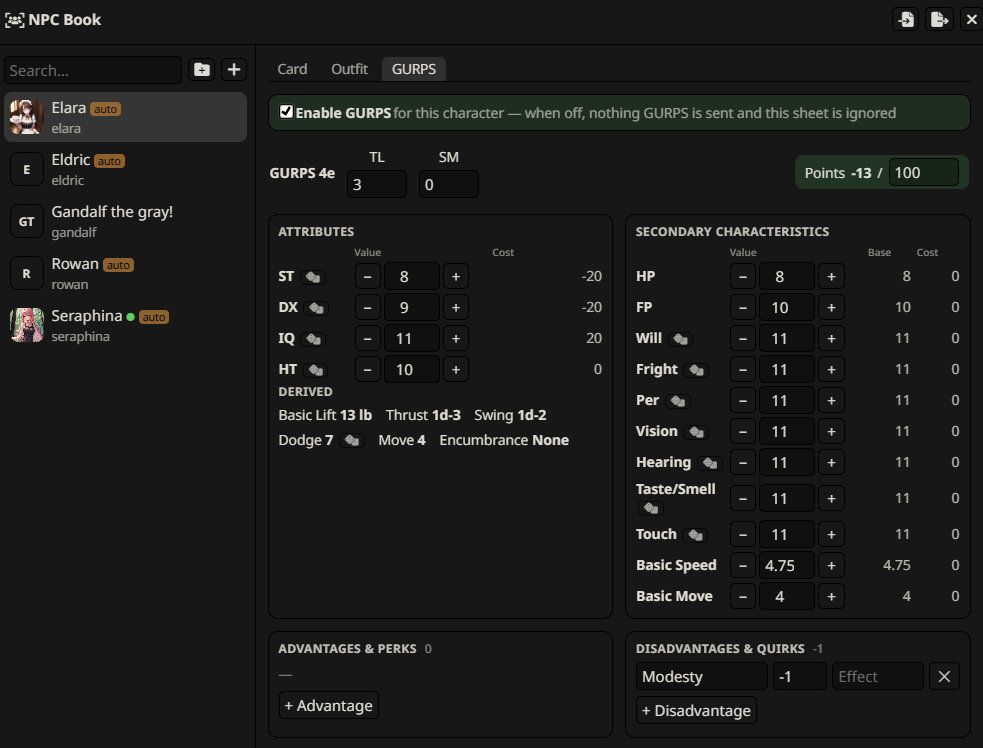
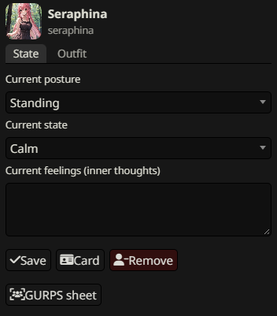

# NPC Book Character Sheet (SillyTavern extension)

A sister extension for [NPC Book](https://github.com/lalzy/ST-NPC-Book) that gives every NPC, and you, a character sheet (intended for use with the **GURPS® system**). Note that **No rules data is included** so you need to define all this yourself in **Extensions → NPC Book Character Sheet → Rules** (see [RULES.md](RULES.md)). Until you do, the sheet still works as a plain record: it stores what you type, sums trait points and lets you roll against any value.



# Install
In SillyTavern, open **Extensions** (the stacked-cubes icon) → **Install extension**, paste this link and install:

```
https://github.com/lalzy/ST-NPCBook-Character-Sheets
```

Or install it manually: download this repository and put the files in `SillyTavern/data/<your-user>/extensions/NPC-Book-GURPS/`, then reload SillyTavern.

**If NPC Book is missing, you get a warning a few seconds after loading and nothing else happens.**

# Using it

### During Chat
To open current character(or user)'s stat sheet, click on the chat sheet and press the new Character Sheet button




### New NPC Sheets:
Press the  button ontop of the character bar in the chat to toggle on/off character-sheet generation on new NPCs.


# LLM Fine-Tuning
This extention will work better if you fine-tune your own model, to this end here is how the character-sheet is sent to the LLM so you can use this to generate your training data


```
<user name="Aldo">
  <description>A wandering bard with a quick tongue.</description>
  <state posture="standing"/>
  <wearing>Upper (outer): Green tunic; Lower (outer): Wool trousers; Feet (outer): Leather boots</wearing>
  <sheet>
    <traits>
      <Charming pt="5" effect="people like him"/>
    </traits>
    <skills>
      <Singing level="14" Pt="14"/>
      <Fast-Talk level="13" Pt="13"/>
    </skills>
    <equipment>
      <Lute weight="3" value="$60" category="tool" stat="fine" effect="lucky charm"/>
      <Dagger weight="0.5" value="$20" category="weapon" stat="1d-1 imp"/>
      <Padded_jack weight="6" value="$40" category="armor" stat="DR 1"/>
    </equipment>
    <abilities>
      <Soothe kind="spell" use="utility" does="buff +1 all, 3 turns" on="ally" level="14" range="5" cost="2" effect="a calming song"/>
    </abilities>
    <reaction_modifiers>
      <modifier name="Smooth talker" townsfolk="+1"/>
      <modifier name="Debtor" innkeepers="-2" moneylenders="-4"/>
    </reaction_modifiers>
  </sheet>
</user>
<characters>
<char name="Brenna" id="brenna">
  <identity race="human" age="27" gender="female" role="warrior" pronouns="she/her"/>
  <details>A sellsword with a temper.</details>
  <dialogue_examples>
    <example>Coin first, then we talk.</example>
  </dialogue_examples>
  <state posture="standing" mood="wary"/>
  <feelings>distrusts strangers</feelings>
  <wearing>Upper (outer): Leather coat; Lower (outer): Wool trousers; Feet (outer): Riding boots</wearing>
  <sheet>
    <traits>
      <Alert pt="5" effect="notices ambushes"/>
      <Bad_Temper pt="-10" effect="loses her cool when insulted"/>
    </traits>
    <skills>
      <Broadsword level="13" Pt="13"/>
      <Shield level="12" Pt="12"/>
      <Intimidation level="14" Pt="14"/>
    </skills>
    <equipment>
      <Broadsword weight="3" value="$500" category="weapon" stat="2d+1 cut" effect="family heirloom"/>
      <Round_shield weight="6" value="$60" category="shield" stat="DB 2" effect="dented rim"/>
      <Chain_shirt weight="15" value="$150" category="armor" stat="DR 4, torso"/>
      <Leather_coat weight="4" value="$50" category="clothing" effect="worn"/>
      <Healing_draught qty="3" weight="0.5" value="$20" category="consumable" stat="heals 1d"/>
      <Rations qty="4" weight="0.5" value="$2" category="supplies"/>
      <Coin_purse value="$85" category="valuable"/>
    </equipment>
    <abilities>
      <Shield_bash kind="technique" use="melee" does="1d cr" on="enemy" level="12" reach="1" effect="knocks foes back"/>
      <War_cry kind="power" use="utility" does="debuff -1 attack, 2 turns" on="enemy" level="14" range="10" cost="1" effect="a shout that shakes foes"/>
    </abilities>
    <reaction_modifiers>
      <modifier name="Hot-headed" everyone="-1"/>
      <modifier name="Veteran of the Siege" soldiers="+2" nobles="+1"/>
      <modifier name="Deserter" city_guard="-3"/>
    </reaction_modifiers>
  </sheet>
</char>
</characters>
```